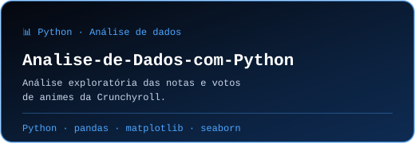

---

# 👨‍💻 Sobre mim

Olá! Meu nome é **Cauê Teles**.

Sou estudante de **Análise e Desenvolvimento de Sistemas (ADS)** pelo **Senac**, apaixonado por tecnologia e desenvolvimento de software.

Tenho conhecimentos em:

- 🐍 Python
- ☕ Java
- 📊 Análise de dados com Python
- 🌐 HTML5
- 🎨 CSS
- 🗄️ SQL e Banco de Dados (MySQL e Oracle)
- 🔧 Git
- 🐙 GitHub
- 🖥️ Hardware
- 🪟 Windows
- 🐧 Linux
- 🍎 macOS

Estou constantemente estudando e desenvolvendo projetos para aprimorar minhas habilidades em programação, dados e tecnologia.

---

# 🚀 Tecnologias

  

🗄️ SQL é a linguagem de consulta; MySQL e Oracle Database são os sistemas de banco de dados que estudo.

---

# 📂 Projetos

*Projetos de estudo e prática, da lógica de programação em Java à análise de dados com Python.*

<table>
  <tr>
    <td colspan="2" align="center">
      
    </td>
  </tr>
  <tr>
    <td>
      
    </td>
    <td>
      
    </td>
  </tr>
</table>

---

# 📊 GitHub Stats

---

# 🔥 GitHub Streak

---

# 📈 GitHub Activity

---

# 🏆 GitHub Trophies

---

# 🐍 Contribution Snake

---

# 🌐 Contato

---

